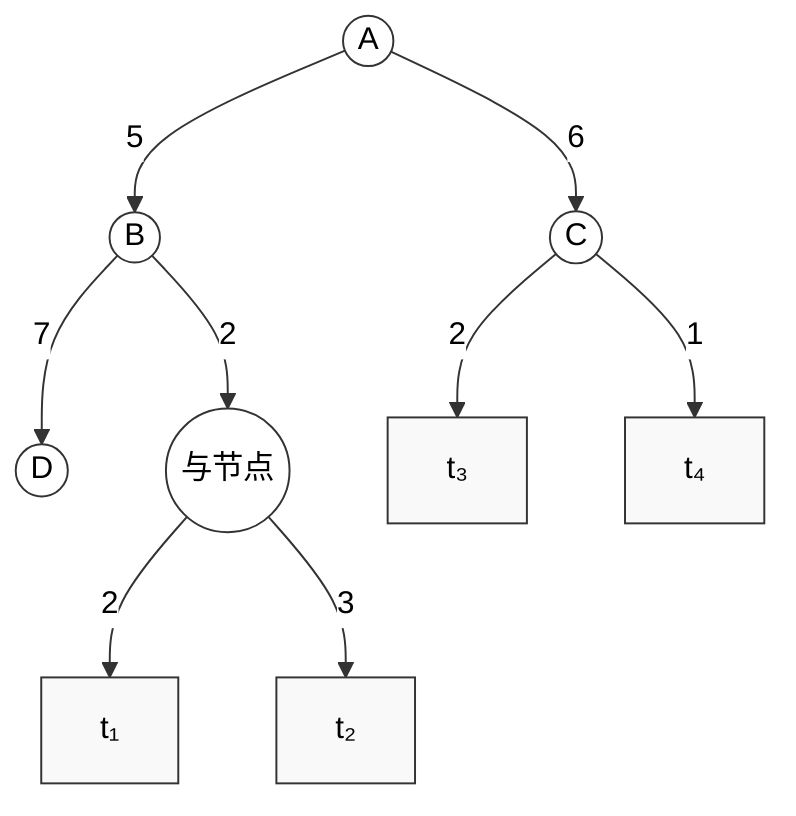

## 一、多选题

1. 求解树的代价时候，若节点 $x$ 是与节点，则它的代价可以这样求___________ **【 正确答案: BC 】** [4（3）.1.1](题目讲解/4（3）.1.1.md) | [第十章：与或图搜索](../章节分述/第十章：与或图搜索.md)
    
    - A. $g(x) = \min \{c(x, y_i) + g(y_i)\}$  
        
    - B. $g(x) = \max \{c(x, y_i) + g(y_i)\}$  
        
    - C. $g(x) = \sum \{c(x, y_i) + g(y_i)\}$  
        
    - D. 以上都可以
        
2. 在有序搜索中，如果节点 $x$ 在希望树中，若 $x$ 是___________ **【 正确答案: C 】**，则其所有子节点都在希望树中。 [4（3）.1.2](题目讲解/4（3）.1.2.md) | [什么是希望树](../概念分述/什么是希望树.md)
    
    - A. 终叶节点
        
    - B. 端节点
        
    - C. 与节点
        
    - D. 或节点
        

## 二、填空题

1. 在有序搜索中，应选择那些最有希望成为最优解树一部分的节点进行扩展。我们称这些节点构成的树为______ **【 正确答案: 希望树 】**
    
2. 设有如下图的与/或树，请分别按和代价法及最大代价法求解树的代价
    

- 和代价是______ **【 正确答案: 21 】**
    
- 最大代价是______ **【 正确答案: 10 】**

[和代价与最大代价](../概念分述/和代价与最大代价.md)

## 三、判断题

1. 如果已确定某个节点为可解节点，则其不可解的后继节点可以从搜索树中删除，如果确定某个节点不可解节点，则其全部后继节点都可以从搜索树中删除。 **【 正确答案: 正确 】**
    
2. 在有序搜索中，如果节点 $x$ 在希望树中，且其子节点依次为 $y_1, y_2, \dots, y_n$，则具有 $\min \{c(x, y_i) + g(y_i)\}$ 的子节点也在希望树中 **【 正确答案: 错误 】** [4（3）.3.2](题目讲解/4（3）.3.2.md)
    
3. 与或图搜索是寻找解树的过程，解树是与或图中所有可解节点的子图 **【 正确答案: 正确 】** [4（3）.3.3](题目讲解/4（3）.3.3.md)
    
4. 标示可解与不可解节点的过程是自上而下进行的 **【 正确答案: 错误 】** [4（3）.3.4](题目讲解/4（3）.3.4.md)
    
5. 与或树的搜索过程只是可解节点的识别与标注过程 **【 正确答案: 错误 】** [4（3）.3.5](题目讲解/4（3）.3.5.md)